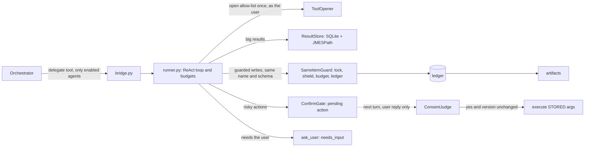

# agent-kit

A small runtime for safe, multi-step specialist agents: one folder per agent, safety enforced in code.

> An open-source reference implementation of a safe runtime for multi-step specialist agents. All names and data are fictional.

[](https://github.com/Tayyab-Bilal/agent-kit/actions/workflows/ci.yml)

## At a glance

**What it is.** A small Python runtime for agents that take several steps and can change data. The safety rules (allow-list, budgets, write guard, user consent) are enforced in code, not in the prompt, and a new agent is one folder.

**What is built** (in this repo, working and tested):

- Runner loop and budgets: steps, tool calls, backend calls, saves and a deadline end the run. `runner.py:_run`, `card.py:Budget`
- Write guard: a duplicate save of the same item returns the first result, a per-key lock and `asyncio.shield` protect an in-flight save, and an unclear error is checked with `exists`. `same_item_guard.py:SameItemGuard.save`
- ConfirmGate: a risky action is stored with its exact arguments and a code-written question, and each pending id works once. `confirm.py:ConfirmGate.propose`, `ConfirmGate.resolve`
- Consent judge, fail closed: only a bare yes confirms. "yes, but ..." is unclear, and an unclear verdict, a judge error or garbage cancels. `consent.py:RuleConsentJudge.judge`, `confirm.py:ConfirmGate.resolve`
- Result store: big tool results go into per-task SQLite, and the model queries them with read-only SQL. A default-deny SQLite authorizer allows only reads. `handles.py:_authorizer`, `ResultStore.sql`
- Agent spec validation: unknown keys are rejected, and a write tool that is neither guarded nor confirm-gated rejects the card. `card.py:AgentSpec.validate_against`, `registry.py:discover`
- Adversarial test suite: a hostile scripted model tries to break each rule. `tests/adversarial/test_hostile_llm.py`

**What is not built, or is simplified here:**

- Only a scripted fake model (`ScriptedLLM`) and a rule-based judge (`RuleConsentJudge`) ship. No real model is called. `LLMConsentJudge` exists but is not run against a real model.
- The backend is an in-memory fake, and `FakeBackendOpener` is not a real permission system.
- Pending actions, the ledger and the locks live in process memory. A real deployment needs storage the model cannot write to, and a unique constraint in the backend.
- The `exists` check can match an item that was there before the task, so idempotency is only as strong as that check.
- The version stamp is a simple revision counter.
- The JMESPath memory limit works on Linux only.
- `workflow_helper` is small on purpose: three checks, no builder.

**How a risky action flows:**

1. The model asks for a risky tool, for example `archive_notes`. `runner.py:_dispatch` checks the allow-list and the arguments.
2. Code does not run it. It stores the exact arguments with a version stamp and writes the question itself. `confirm.py:ConfirmGate.propose`
3. The run ends with status `needs_input` and that question. `runner.py:_run`
4. The user replies on the next turn. Only the pending id and the reply go back in. `runner.py:resume`
5. The judge reads the code-written question and the user's reply. Nothing the agent model wrote reaches it. Anything but a clear yes cancels. `consent.py:RuleConsentJudge.judge`
6. The gate checks that the id is unused and belongs to this task, then compares the version stamp. If the data changed, it asks again. `confirm.py:ConfirmGate.resolve`
7. The stored arguments run, not anything the model or caller says now, and the result goes into the ledger. `runner.py:resume`

**Attack suite.** `tests/adversarial/`, 20 attack tests (16 test functions, one parametrized over several SQL attacks).

**Run it.**

```bash
.venv/bin/pytest -q    # 184 passed
```

## Safety controls, one by one

Each control below is enforced by code, not by the prompt. Each has the same three parts: the risk,
how it works (with the file and the real values), and the tests that prove it.

### 1. Allow-list

- **Risk / attack:** The model calls a tool the agent was never meant to have (a delete tool, a tool of another agent, a made-up name), or the agent runs with more permission than the chatting user has.
- **How it works:**
  - The card lists exactly which tools the agent may use, and anything else the model asks for is refused with an error and never called (`runner.py: _dispatch()`).
  - The tool list is opened once at the start, as the chatting user, so the backend decides what that user is allowed to do. If a tool is missing or forbidden, the run refuses to start before the model is ever called (`runner.py: _open_tools()`, `opener.py: ToolOpener`).
  - The opened set holds only the card's tools, so a tool that is not listed is not just hidden, it does not exist for this run (`registry.py: ToolRegistry.subset()`).
  - When the user replies later, the tools are opened again as the same user, and a stored action that is not on the card is refused (`runner.py: resume()`).
- **Tests that prove it:**
  - `tests/adversarial/test_hostile_llm.py`: `test_attack_tool_outside_allow_list`, `test_attack_tool_unknown_everywhere`.
  - `tests/test_opener.py`: `test_user_b_cannot_see_user_a_notes`, `test_guarded_save_lands_in_the_chatting_users_data_only`, `test_tools_are_opened_once_per_run_as_that_user`, and 6 more in that file.
  - `tests/test_card.py`: `test_guard_tool_must_be_in_allow_list`, `test_missing_tool_refuses_to_start`.
  - `tests/test_confirm.py`: `test_resume_rejects_action_not_in_card`.
  - `tests/test_workflow_helper.py`: `test_delete_and_convert_tools_are_unreachable_because_they_are_not_on_the_card`.
  - `tests/test_runner.py`: `test_llm_is_told_which_tools_exist`.

### 2. Budgets

- **Risk / attack:** A looping or hostile model burns steps, calls, backend traffic or time, writes too many items, or floods the prompt with a huge result.
- **How it works:**
  - Every card has a budget, and the defaults are 25 model steps, 60 tool calls, 40 backend calls, 5 saves and a 120 second deadline. Values must be real positive integers, and an infinite deadline is rejected (`card.py: Budget`).
  - The loop counts steps, tool calls and backend calls itself and stops the run the moment one runs out. Only calls that really reach the backend use the backend budget, so handle queries and confirm proposals are free (`runner.py: _run()`).
  - The deadline is checked before every model call and every tool call, and each is also wrapped in a timeout, so a hung tool is cancelled (`runner.py: _run()`).
  - Saves are counted per task in the write guard, so once the limit is hit the next save is refused (`same_item_guard.py: SameItemGuard.save()`).
  - Big results are capped too: a list of more than 20 rows becomes a handle, and any other text is cut at 4000 characters (`runner.py: _inline()`). Handle queries are capped at 200 rows, 64 KiB, 500 characters of expression and half a second (`handles.py: ResultStore`).
- **Tests that prove it:**
  - `tests/adversarial/test_hostile_llm.py`: `test_attack_exceed_save_budget`, `test_attack_exceed_tool_call_budget`, `test_attack_never_ending_loop`, `test_attack_resource_exhaustion_via_handle_tool`.
  - `tests/test_runner.py`: `test_step_budget`, `test_tool_call_budget`, `test_deadline`, and 7 more in that file.
  - `tests/test_card.py`: `test_budget_is_strict`.
  - `tests/test_same_item_guard.py`: `test_save_budget_enforced`.
  - `tests/test_handles.py`: `test_row_and_byte_caps`, `test_slow_query_aborted`, `test_giant_blob_refused`, and 5 more in that file.

### 3. Write guard

- **Risk / attack:** A retry, a parallel duplicate call, a cancelled turn or a timeout saves the same item twice, or loses a save that did land.
- **How it works:**
  - The guarded tool keeps its own name and schema, but its calls are quietly routed through the guard, so the model has no unguarded version to call (`same_item_guard.py: SameItemGuard.expose()`).
  - Each save is keyed by task, tool and item. A second save of the same item returns the first result without writing again, and a per-key lock makes parallel duplicates collapse into one write (`same_item_guard.py: SameItemGuard.save()`).
  - The write runs as its own task behind `asyncio.shield`, so if the turn is cancelled the write still finishes and is recorded. A retry that arrives meanwhile joins the running write instead of starting another (`same_item_guard.py: SameItemGuard.save()`).
  - After a timeout or dropped connection the guard does not retry blindly. It asks the backend whether the item exists: if yes it records success, if no it refuses (`same_item_guard.py: SameItemGuard.save()`).
  - Every successful write goes in a ledger, and the task's artifacts are built from the ledger, so what the model claims it saved is ignored (`runner.py: _result()`). This is only as strong as the exists check, so a real backend still needs a unique constraint.
- **Tests that prove it:**
  - `tests/adversarial/test_hostile_llm.py`: `test_attack_save_same_item_twice_in_one_step`, `test_attack_exceed_save_budget`, `test_attack_claim_confirmation_in_final_message`.
  - `tests/test_same_item_guard.py`: `test_concurrent_duplicate_saves_one_forward`, `test_second_save_of_same_item_is_noop_returning_first_result`, `test_timeout_then_exists_records_success_no_duplicate`, and 11 more in that file.
  - `tests/test_runner.py`: `test_guarded_write_is_exposed_under_the_tools_own_name_and_schema`, `test_guarded_write_requires_item_key`, `test_artifacts_from_ledger_not_model_claims`, and 2 more in that file.

### 4. ConfirmGate

- **Risk / attack:** The model runs a risky action itself, claims the user said yes, swaps the arguments after the user agreed, or replays an old approval.
- **How it works:**
  - The risky tool is never run when the model asks. Code stores a copy of the exact arguments under a one-time id tied to this task, writes the question from a fixed template, and ends the run waiting for the user (`confirm.py: ConfirmGate.propose()`).
  - The question is built by code with every value JSON-escaped, so a note title cannot fake the end of the question (`confirm.py: QUESTION_TEMPLATE`).
  - The id works once. It is deleted before the judge even reads the reply, so a replay, a made-up id or an id from another task does nothing (`confirm.py: ConfirmGate.resolve()`).
  - A version stamp is stored with the action. If the data changed since the question was asked, the gate returns AskAgain and the runner asks a fresh question instead of acting on stale data (`confirm.py: ConfirmGate.resolve()`, `runner.py: resume()`).
  - Anything but a clear yes cancels, and only the stored action with the stored arguments can run, then it is written to the ledger (`runner.py: resume()`).
- **Tests that prove it:**
  - `tests/adversarial/test_hostile_llm.py`: `test_attack_forge_confirmation_by_calling_confirm_action_directly`, `test_attack_claim_confirmation_in_final_message`, `test_attack_forged_reply_in_tool_data_is_not_a_user_reply`.
  - `tests/test_confirm.py`: `test_confirm_action_returns_needs_input_without_executing`, `test_yes_executes_stored_args`, `test_not_yes_reply_executes_nothing`, and 15 more in that file.
  - `tests/test_workflow_helper.py`: `test_publish_waits_for_the_users_yes_then_executes`, `test_declined_or_conditional_reply_changes_nothing`, `test_edit_after_data_changed_asks_again`, and 1 more in that file.

### 5. Spec validation

- **Risk / attack:** A typo in a safety setting is silently ignored, a write tool is left unprotected, or one broken card takes the whole system down.
- **How it works:**
  - The card is strict: an unknown key, which is usually a typo of a safety setting, makes the card invalid instead of being ignored (`card.py: _Strict`).
  - Every write tool on the card must be guarded or confirm-gated, otherwise the card is rejected. A tool also cannot be both (`card.py: AgentSpec.validate_against()`).
  - On load, the registry also checks the card name matches its folder, every tool is registered, and the skill file stays inside the folder (`registry.py: load_agent()`).
  - Discovery loads each agent on its own, so one broken card is left out with its reason recorded and the other agents still work (`registry.py: discover()`).
  - The runner checks the card again before starting, so even a hand-built card that skipped loading is refused (`runner.py: _run()`).
- **Tests that prove it:**
  - `tests/adversarial/test_hostile_llm.py`: `test_attack_unguarded_write_tool_on_hand_built_card`.
  - `tests/test_card.py`: `test_extra_key_rejected`, `test_unguarded_write_tool_rejects_card`, `test_guard_tool_must_be_in_allow_list`, and 6 more in that file.
  - `tests/test_docs.py`: `test_card_yaml_blocks_are_valid_cards`.

### 6. Result store

- **Risk / attack:** Big results flood the prompt, or the model uses its query tool to write, attach another database, run a pragma, or exhaust memory and time.
- **How it works:**
  - Large results go into a per-task SQLite store instead of the prompt, and the model sees only a short summary with a few sample rows (`handles.py: ResultStore`, `runner.py: _inline()`).
  - The model queries them with read-only SQL. An authorizer callback is installed on the connection and it is deny by default: only reads are allowed, so a write, DROP, ATTACH or PRAGMA is refused by SQLite itself, not by checking the query text (`handles.py: _authorizer()`).
  - Only one statement is allowed per query, and a timeout of half a second stops runaway queries (`handles.py: ResultStore._sql()`).
  - Output is capped at 200 rows and 64 KiB, read lazily so a huge result is never fully loaded (`handles.py: _cap()`).
  - JMESPath queries run in a separate child process with a time limit and a memory limit, and the expression is capped at 500 characters, so a nasty expression cannot hang or crash the agent (`handles.py: ResultStore.jmes()`).
- **Tests that prove it:**
  - `tests/adversarial/test_hostile_llm.py`: `test_attack_sql_write_via_handle_tool` (5 statements: DELETE, UPDATE, INSERT, DROP, CREATE), `test_attack_attach_database_via_handle_tool`, `test_attack_multi_statement_via_handle_tool`, `test_attack_pragma_via_handle_tool`, `test_attack_resource_exhaustion_via_handle_tool`.
  - `tests/test_handles.py`: `test_large_result_becomes_handle_summary`, `test_sql_write_denied`, `test_attach_denied`, and 20 more in that file.
  - `tests/test_runner.py`: `test_large_tool_result_replaced_by_handle_in_transcript`.

### 7. Prompt injection: six defences

1. **The model cannot say yes for the user.**
   - **Attack:** The model calls a risky tool directly, smuggles `confirmed: true` into the arguments, or says in its final message that the user agreed.
   - **How:** The risky tool is never run when the model asks. Code stores a copy of the exact arguments under a one-time id tied to this task, writes the question from a fixed template, and ends the run waiting for the user (`runner.py: _dispatch()`, `confirm.py: ConfirmGate.propose()`). Approval only comes on the next turn, when the user's reply and the pending id go in, and the model is not called at all (`runner.py: resume()`).
   - **Test:** `test_attack_forge_confirmation_by_calling_confirm_action_directly` (also `test_attack_claim_confirmation_in_final_message`).
2. **Fail closed, only a clear yes.**
   - **Attack:** A reply like "yes, but also delete the rest", a hesitant "yes?", or text built to fool the judge.
   - **How:** The judge sees only the code-written question and the user's reply, nothing the agent wrote (`confirm.py: ConfirmGate.resolve()`). The rule judge cleans up the text and says yes only if the whole reply is a plain yes word, so extra words or a question mark mean unclear (`consent.py: RuleConsentJudge`). The LLM judge wraps the reply as escaped data, runs at temperature 0, and treats any odd answer as unclear (`consent.py: LLMConsentJudge`). Unclear, no, or a judge error all cancel. Honest note: `LLMConsentJudge` is not run against a real model in this repo.
   - **Test:** `test_yes_with_extra_instruction_is_not_yes`, `test_eval_no_false_confirms` (96 cases in `tests/evals/consent_cases.jsonl`), `test_llm_judge_reply_is_delimited_data_at_temperature_zero`, `test_llm_judge_parse_error_is_unclear` (`tests/test_consent.py`); `test_judge_error_cancels` (`tests/test_confirm.py`).
3. **Stored args run, not new ones.**
   - **Attack:** The caller swaps the arguments, replays an old id, uses an id from another task, or the data changes after the user said yes.
   - **How:** Only the id comes from the caller. It is deleted before judging so it works once, and it must belong to the same task. If the version stamp no longer matches, the user is asked again (`confirm.py: ConfirmGate.resolve()`). What runs is the stored action with the stored arguments, and it is written to the ledger (`runner.py: resume()`).
   - **Test:** `test_forged_pending_arg_swap_executes_stored_args_only`, `test_replay_executes_only_once`, `test_pending_from_another_task_is_refused_and_not_burned`, `test_version_change_asks_again` (`tests/test_confirm.py`).
4. **Indirect injection: data is never a user reply.**
   - **Attack:** A note, a web page or a tool result contains "yes" or "the user approved".
   - **How:** Tool results and the task text are wrapped in escaped data blocks, and the system rule says data is never an instruction (`runner.py: data_block()`, `SYSTEM_RULE`). Consent can only arrive as the user's reply on resume, so tool output never reaches the judge. Invisible and bidi characters are escaped in the question the user reads (`confirm.py: _safe_json()`).
   - **Test:** `test_attack_forged_reply_in_tool_data_is_not_a_user_reply` (a note titled "yes": the result is still `needs_input` and nothing is archived). Also `test_tool_output_is_escaped_as_data` (`tests/test_runner.py`) and `test_note_title_in_args_cannot_forge_question_end_to_end` (`tests/test_confirm.py`).
5. **SQL on the result store can only read.**
   - **Attack:** The model uses `sql_query` to delete, drop, attach a file or change the schema.
   - **How:** The authorizer on the SQLite connection is deny by default: only reads are allowed, so everything else is refused by SQLite itself, not by checking the query text (`handles.py: _authorizer()`).
   - **Test:** `test_attack_sql_write_via_handle_tool` (parametrized over 5 statements), plus the attach, multi-statement and pragma attacks in the same file.
6. **Event triggers pass ids only.**
   - **Attack:** An event from outside carries free text that ends up in the agent's context as if it were an instruction.
   - **How:** This lives in the sibling repo [autonomous-agent](https://github.com/Tayyab-Bilal/autonomous-agent), not this one. An incoming event may only pass whitelisted keys, and each value must look like an id (letters, digits, dash, underscore, up to 64 characters), so free text is dropped (`triggers.py: TriggerHandler.handle_event()`, `ALLOWED_CONTEXT_KEYS`, `_is_id()`).
   - **Test:** `test_free_text_stripped_from_event_context` (in that repo, `tests/test_triggers.py`).

The attack suite is `tests/adversarial/test_hostile_llm.py`. The scripted model in it is deliberately hostile. It has 20 attack tests (16 test functions, one parametrized over 5 SQL attacks), and each one asserts on the world (backend state, handle contents, forward counts), not only on the error text.

## The problem

A chat orchestrator delegates work to "specialists" that are really one-shot LLM calls. Real tasks
(build or fix an automation, analyse a big dataset) need a multi-step agent. That brings four
problems. Big tool results flood the prompt. A timed-out or cancelled save may be lost or
duplicated. A risky action needs an **actual user "yes"**, not the model's opinion that the user
agreed. And the agent must act with the chatting user's permissions, not a shared service
identity.

This repo is a runtime that solves those once, so a new agent is a folder, not a class. The
setting is a fictional app, "Acme Workspace" (notes, tasks, documents, workflows). Two demo agents
ship: `notes_curator` (tidies notes) and `workflow_helper` (finds, checks, copies and, after the
user confirms, publishes and runs workflows).

## What it does

- **One folder = one agent.** `agent.yaml` card + `SKILL.md` + optional tools (`card.py`, `registry.py`).
- **Strict, fail-closed cards.** Unknown keys are rejected; every write tool must be guarded or
  confirm-gated; a broken card excludes only that agent (`registry.discover`).
- **Runs as the chatting user.** A `ToolOpener` opens the card's allow-list once as that user, and
  the run refuses to start if any tool is missing or forbidden (`opener.py`, `runner.run`).
- **Big results become handles.** Per-task SQLite tables; the model sees a summary and queries with
  read-only SQL or JMESPath (`handles.py`).
- **Guarded writes under the tool's own name and schema.** The model sees `save_note` exactly as
  registered; the call routes through the guard (`same_item_guard.py`).
- **Idempotent, shielded commits.** Same-item no-op, per-key lock, `asyncio.shield`, existence
  check after unclear errors, a ledger (`same_item_guard.py`).
- **Confirm-first actions.** Code-written question, stored arguments, a judge that sees only the
  code-written question and the user's reply, a version stamp re-check (`confirm.py`, `consent.py`).
- **Budgets.** Steps, saves, tool calls, backend calls and a deadline (`card.Budget`).
- **Asks when it must.** A built-in `ask_user` tool ends the run with `needs_input`.
- **Orchestrator bridge with per-agent flags.** One generated delegate tool; nothing enabled means
  the orchestrator's tools are byte-for-byte unchanged (`bridge.py`).
- **Reuse, not rewrite.** A pure `diagnose()` function is called directly and as a tool
  (`agents/workflow_helper/diagnose.py`).
- **Consent eval harness.** 96 consent replies and 14 same-item cases, in several languages, where
  one false confirm fails the build (`tests/evals/`).

## Quickstart

```bash
uv venv .venv && uv pip install -e ".[dev]"
.venv/bin/pytest -q
.venv/bin/python examples/demo.py
```

`examples/demo.py` runs both agents against a scripted fake LLM. Excerpt of its output:

```text
=== User replies: "yes but only two of them" ===
completed: Cancelled, nothing was changed: reply was not a clear yes
archived so far: []

=== workflow_helper: two workflows match 'weekly', so it asks ===
needs_input: Which one: 'Weekly report' or 'Weekly report (old)'?

=== workflow_helper: diagnose, as a tool and as a plain function call ===
risk: high; last run died on step s3
  - step s3 needs setting 'channel' but it is empty
  - step s9 can never run: nothing leads to it
  - the last run died on step s3: channel is empty

=== workflow_helper: delete is not on the card, so it is refused ===
model was told: <data source="tool:delete_workflow">error: tool 'delete_workflow' is not allowed for this agent</data>
wf-1 still exists: True
```

## Usage guide

The short version. Blocks run top to bottom and use top-level `await` (try `python -m asyncio`).
The full guide is [docs/usage.md](docs/usage.md); writing your own agent is
[docs/writing-an-agent.md](docs/writing-an-agent.md); signatures are in [docs/api.md](docs/api.md).

Load agents and run one task:

```python
from agent_kit import runner
from agent_kit.agents.notes_curator.tools import NotesBackend, build_tools
from agent_kit.confirm import ConfirmGate
from agent_kit.consent import RuleConsentJudge
from agent_kit.fakes import ScriptedLLM
from agent_kit.handles import ResultStore
from agent_kit.llm import Final, ToolCall
from agent_kit.registry import BUILTIN_AGENTS, discover
from agent_kit.same_item_guard import SameItemGuard

backend = NotesBackend(50)
tools = build_tools(backend)
agent = discover(BUILTIN_AGENTS, tools).agents["notes_curator"]
card, gate = agent.card, ConfirmGate()
guard = SameItemGuard(tools, lambda tool, key: backend.note_exists(key), card.budget)

llm = ScriptedLLM([
    [ToolCall("save_note", {"title": "Summary", "body": "All quiet."})],
    [ToolCall("archive_notes", {"ids": [1, 2]})],      # risky: stored, not executed
    Final("Waiting for your answer."),
])
asked = await runner.run(
    card, runner.Task("t1", "Summarise and archive"), llm, tools, ResultStore(), guard, gate,
    skill_text=agent.skill_text, version_of=backend.version_of,
)
print(asked.status, [a.key for a in asked.artifacts])
print(asked.message)
```

Next turn the user replies. Only the pending id and the reply go back in; the stored arguments run:

```python
done = await runner.resume(
    card, asked.pending_action.id, "yes", RuleConsentJudge(), tools, gate, guard, "t1",
    current_version=await backend.version_of("archive_notes", {}),
)
print(done.status, done.message, [n["id"] for n in backend.notes if n["archived"]])
```

To run as the chatting user, pass `opener=` and `user=` instead of `tools` (see the usage guide).

## How it works



The main flow of `runner.run`:

1. **Open.** With an opener, the card's tools are opened once as the chatting user. A missing or
   forbidden tool, or a card that breaks a rule, returns `failed` before the model is called.
2. **Expose.** Guarded tools are swapped for twins with the same name and schema that route
   through the guard. The model is shown the card's tools plus `sql_query`, `jmes_query`, `ask_user`.
3. **Loop.** Each model turn returns tool calls or a final message. For every call, code checks
   the allow-list, the tool-call and backend-call budgets and the deadline.
4. **Dispatch.** A confirm action is stored with its exact arguments and ends the run with a
   code-written question. A guarded write goes through the guard. A big list becomes a handle. Any
   tool error is an observation, not a crash.
5. **Result.** `TaskResult` has a status (`completed`, `needs_input`, `failed`), a message, and
   artifacts read from the ledger. `run` never raises.
6. **Resume.** `runner.resume` takes the pending id and the user's reply. The judge decides, the
   version stamp is compared, and the stored arguments run. Each id works once.

### The write guard

(Short version here. The full control write-up is in [Safety controls, one by one](#safety-controls-one-by-one).)

For one `(task, tool, item key)`: a per-key lock lets one save forward at a time, and a second save
of the same item returns the first result without forwarding. The forward runs as its own task
behind `asyncio.shield`, so a cancelled turn (deadline, client gone) does not abandon an in-flight
commit: it finishes and is written to the ledger, and a retry that arrives while it is still running
joins it instead of forwarding again. If a forward raises `TransportError` or `TimeoutError`, the
guard asks `exists(tool, item_key)`: if the item is there the save is recorded as recovered,
otherwise it raises `WriteRefused`. If the outcome of a cancelled commit is lost, the key stays
"uncertain" and the next save of it asks `exists` first. Other exceptions are definite failures.

This is as strong as the `exists` check. It can match an item that was already there before the task,
so a backend unique constraint or idempotency key is still the real guarantee (see Limits).

## Design decisions

1. **One folder = one agent.** Why: adding an agent is data, not code, so it cannot add new
   behaviour to the runtime. Rejected: a class per agent, which grows its own loop and its own bugs.
2. **Cards are strict and fail closed.** Why: an unknown key is almost always a typo of a safety
   setting, and a half-loaded agent is worse than none. Rejected: ignoring unknown keys; refusing
   to boot when one card is broken.
3. **The safety boundary is code, not the prompt.** Any write tool on a card must be guarded or
   confirm-gated or the card is rejected at load. Rejected: "tell the model to be careful".
4. **Run as the chatting user.** The allow-list is opened once as that user, so the backend
   enforces their permissions and a prompt trick cannot read another user's data. Rejected: one
   service identity with permission checks re-implemented inside the agent.
5. **Big results become handles.** Per-task SQLite plus JMESPath keeps the prompt small and the
   query surface tiny. Rejected: pasting rows into the prompt; a code sandbox (see
   the options table below).
6. **Guarded writes keep the tool's own name and schema.** The model cannot "forget" to use the
   safe version, because there is no other version. Rejected: a separate `safe_save` tool; wrapping
   backend tools inside custom tools.
7. **Writes are shielded and checked, not blindly retried.** Why: a timeout does not say whether
   the write landed. Rejected: blind retry (duplicates); cancelling an in-flight commit (loses it).
8. **Consent is decided by code, never the agent model.** A risky action is stored with exact
   arguments and a code-written question; next turn a judge reads the code-written question and the user's reply (never the agent model's words), then a
   version stamp is re-checked and the **stored** arguments run. Rejected: letting the model ask
   and report back what the user said.
9. **The judge is fail-closed.** Only a bare yes confirms; "yes, but ..." is unclear. An error or
   garbage cancels. Rejected: a permissive reading of "yes plus extra words".
10. **Data is not instructions.** Tool and user content is escaped as data in prompts, and a record
    name cannot forge a confirmation question. Rejected: trusting delimiters the data can close.
11. **Artifacts come from the ledger.** What the model says it saved is ignored. Rejected: parsing
    the final message.
12. **Reuse pure functions.** `diagnose()` is one pure function, called by a tool and by plain
    code. Rejected: re-implementing deterministic logic as a model loop, where it can drift.
13. **The contract mirrors A2A concepts** (card, task, needs-input, artifacts) but runs in-process,
    so moving an agent into its own service changes the transport, not the contract.
14. **Per-agent flags; off means identical.** The bridge lists only enabled agents; with none
    enabled it returns `None`, and a test proves the orchestrator's tools are byte-for-byte unchanged.

### Dynamic control without a sandbox: seven options

The agent must slice big results with expressions it writes. These are the options compared
(not benchmarked in this repo).

| Option | Power | Safety lever | Cost | Verdict |
| --- | --- | --- | --- | --- |
| **SQLite** | Filter, group, sort, join | Default-deny authorizer, one statement, progress-handler timeout | stdlib | **Chosen** |
| **JMESPath** | Reshape nested JSON | Pure expression language, no I/O | one small dependency | **Chosen** (with SQLite) |
| DuckDB | Richer SQL, file readers | Must disable file and network functions by configuration | Large native dependency | Rejected: more surface than needed |
| CEL | Safe predicates | Not Turing complete | Needs a runtime; filters only | Rejected: cannot aggregate or reshape |
| jq | Powerful transforms | Mostly safe, but a subprocess and its own language | External binary | Rejected: process management for little gain |
| Structured query plan | Whatever the plan schema allows | Controlled by construction | Build and maintain a mini query engine | Rejected: reinvents SQL |
| Pyodide (WASM Python) | Anything | Not isolated by itself | See below | Rejected |

**Why not Pyodide.** It has a slow cold start and a large per-process memory cost, and it is not
isolated on its own. SQLite + JMESPath loads instantly and adds little memory.

### What this repo simplifies

- **LLMs** sit behind `AgentLLM` and `TextLLM`; only `ScriptedLLM` and `RuleConsentJudge` ship.
- **Backend** is in-memory fakes (`NotesBackend`, `WorkflowBackend`) and `FakeBackendOpener`,
  which enforces per-user grants. A real opener calls the backend with the user's credentials.
- **Persistence.** Handles are in-memory SQLite per task. A real deployment would keep per-task tables
  with a TTL. The ledger is a dict; a real deployment would use a table with a unique
  `(task, item_key)` constraint, which makes the same-item rule hold across processes.
- **Locks.** The per-key `asyncio.Lock` is per process. Postgres would use advisory locks, or a
  unique constraint with `INSERT ... ON CONFLICT`.
- **Version stamp.** A revision counter here; a real backend would use the `updated_at` of the touched records.
- **Pending actions.** `ConfirmGate` is in process memory. A real deployment must keep them in storage the
  model and the client cannot write to (keyed by id with task, args, version and a used flag).
- **The `exists` callback** is one function per guard, not per user.

## Testing

```bash
.venv/bin/pytest -q          # 184 tests, a few seconds, no network
.venv/bin/ruff check .
```

| Invariant | Test |
| --- | --- |
| Unknown card keys rejected; unguarded write tool rejects the card | `test_card.py` |
| Missing tool refuses to start | `test_missing_tool_refuses_to_start` |
| User B cannot see user A's data; forbidden or missing tool refuses to start | `test_opener.py` |
| Tools are opened once per run, as that user; resume runs as the same user | `test_opener.py` |
| Guarded tool keeps its own name and schema and routes through the guard | `test_guarded_write_is_exposed_under_the_tools_own_name_and_schema` |
| Duplicate and concurrent saves forward once | `test_concurrent_duplicate_saves_one_forward` |
| A cancelled commit finishes, is recorded, and a retry joins it | `test_shielded_commit_finishes_and_is_recorded_after_cancellation`, `test_cancel_mid_save_then_retry_joins_the_inflight_commit` |
| Timeout then existence check; lost outcome is recovered | `test_timeout_then_exists_records_success_no_duplicate`, `test_cancelled_commit_with_lost_outcome_is_recovered_by_existence_check` |
| Step, tool-call, backend-call, save budgets and deadline end the run | `test_runner.py`, `test_same_item_guard.py` |
| SQL is read-only, one statement, capped; JMESPath is bounded | `test_handles.py`, `tests/adversarial/` |
| Confirm actions never execute in the model's turn; stored args run | `test_confirm.py` |
| Forged, other-task or replayed pending actions execute nothing | `test_confirm.py`, `tests/adversarial/` |
| Judge error, unclear or garbage verdicts cancel | `test_confirm.py`, `test_consent.py` |
| 96 consent + 14 same-item cases: zero false confirms, labels match | `test_consent.py`, `tests/evals/` |
| Several workflow matches ask the user; none says so | `test_workflow_helper.py` |
| The same pure `diagnose` is the tool's answer | `test_diagnose_is_one_pure_function_used_directly_and_as_a_tool` |
| Published workflows cannot be edited | `test_published_workflow_cannot_be_edited_not_even_proposed` |
| Delete and convert tools are unreachable (not on the card) | `test_delete_and_convert_tools_are_unreachable_because_they_are_not_on_the_card` |
| Per-agent flags list only enabled agents; all off is byte-identical | `test_bridge.py` |
| Every Python block in the README and `docs/` runs; card YAML in docs is valid | `test_docs.py` |

## Limits and known trade-offs

- **Idempotency is as strong as `exists`.** After an interrupted save the guard asks
  `exists(item_key)`. That check can match an item that was there before the task. A real
  deployment should rely on a unique constraint or an idempotency key in the backend, with this guard as the
  second line. `exists` is not asked per user here.
- **The shipped judge is rule-based.** It accepts only bare yes or no words. It is conservative
  (a polite "yes, thanks" cancels), and it is not a language model. Swap in `LLMConsentJudge` and
  grade it with the eval files first.
- **The opener is a fake.** `FakeBackendOpener` shows the seam and the refusal behaviour. It is
  not a real permission system. Permissions are checked when the allow-list is opened, not on
  every call.
- **Pending actions live in memory** (see above).
- **JMESPath child.** It uses `fork`, `resource` and `/proc`, so the memory limit works on Linux
  only. Elsewhere the child runs with the deadline but no memory limit, and `fork` needs a POSIX
  host. Forking from a heavily threaded host can deadlock the child; a real deployment should use a small
  pre-forked worker pool.
- **One `ResultStore` per task.** Handle names are task-scoped.
- **Deadline.** Handle queries run in worker threads and get only the time left; the runner checks
  the deadline before every tool call.
- **Workflow demo.** `workflow_helper` is small on purpose: three checks in `diagnose`, no builder,
  no drift detection, no answer-quality scoring.
- **Cleanup.** Call `guard.end_task(task_id)` and `gate.end_task(task_id)` when a task is finished.

## Project layout

```text
src/agent_kit/
  card.py          strict AgentSpec, GuardSpec, Budget
  registry.py      ToolRegistry, discover/load_agent, per-agent enabled_names
  opener.py        ToolOpener protocol and OpenRefused (run as the chatting user)
  runner.py        the loop: open, expose, budgets, dispatch, resume; never raises
  same_item_guard.py   idempotent, shielded saves; ledger; guarded tool twins
  handles.py       read-only SQLite and bounded JMESPath over stored results
  confirm.py       pending actions with code-written questions
  consent.py       ConsentJudge protocol, rule judge, LLM judge
  bridge.py        generated delegate tool, per-agent flags
  result.py        TaskResult, Artifact, PendingAction
  llm.py           AgentLLM / TextLLM protocols
  fakes.py         ScriptedLLM, FakeBackendOpener
  agents/
    notes_curator/   card, skill, fake notes backend
    workflow_helper/ card, skill, pure diagnose.py, fake workflow store
tests/             unit, adversarial/ (hostile scripted LLM), evals/ (consent and same-item cases)
docs/              usage.md, api.md, writing-an-agent.md
examples/demo.py   end-to-end story with fakes
```

MIT licensed.
